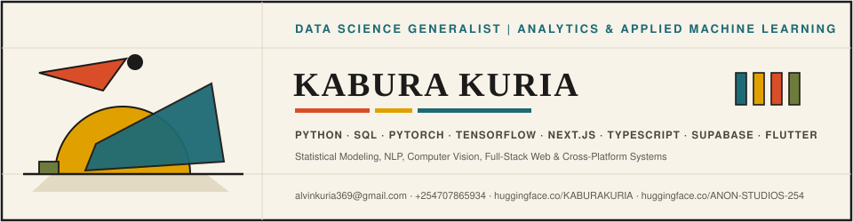
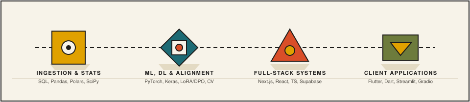
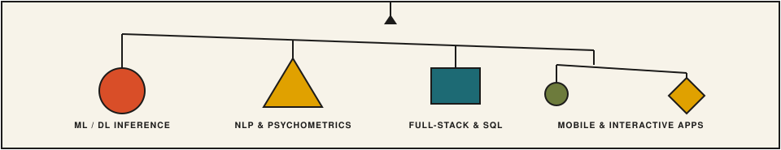

  

## About

Data Science Generalist and Systems Builder working across statistical modeling, applied machine learning, deep neural inference, natural language processing, computer vision, full-stack web engineering, and cross-platform mobile development. Builds end-to-end empirical research notebooks, psychometric instruments, relational data backends, and client-facing applications.

---

  

## Languages and Technical Stack

| Domain | Languages, Frameworks and Platforms |
| :--- | :--- |
| Programming Languages | Python, TypeScript, JavaScript, Dart, SQL, R, Shell / Bash, HTML5, CSS3 |
| Statistical Modeling & Data Science | Pandas, NumPy, SciPy, Polars, Statsmodels, Scikit-learn, Gradient Boosting, Random Forest, Altair, Matplotlib, Seaborn, Plotly, ReportLab, FPDF |
| Deep Learning, Vision & NLP | PyTorch, TensorFlow, Keras, Hugging Face Transformers, Diffusers, Accelerate, Datasets, Unsloth (4-bit LoRA SFT / DPO), OpenCV (SIFT, FLANN, RANSAC), Whisper, CLIP, OWL-ViT, SAM, YOLO, DETR, NLTK, SpaCy, RAG pipelines |
| Full-Stack Web & Mobile | Next.js (App Router), React, Tailwind CSS, PostCSS, Node.js, Bun, Flutter, Streamlit, Gradio, Vercel |
| Databases & Integrations | Supabase (PostgreSQL, Auth, Admin, Row-Level Security, Storage), PostgreSQL, SQLite, MySQL, Paystack API, yfinance, Git / GitHub Actions |

---

  

## Selected Open-Source Work

| Repository / Platform | Focus | Technologies |
| :--- | :--- | :--- |
| [KABURAKURIA/data-analysis](https://github.com/KABURAKURIA/data-analysis) | 100 analytical notebooks spanning survey psychometrics, OLS/logistic regression, NLP sentiment, topic modeling, and network graphs | Python, Pandas, NLTK, Statsmodels |
| [KABURAKURIA/all-ml-ai-dl-tasks](https://github.com/KABURAKURIA/all-ml-ai-dl-tasks) | 84 multimodal AI inference notebooks and 126 interactive web applications across Vision, Speech/Audio, and NLP | PyTorch, Transformers, Diffusers, Streamlit, Gradio |
| [KABURAKURIA/computational-neuroscience](https://github.com/KABURAKURIA/computational-neuroscience) | 27 mathematical modeling notebooks covering Kuramoto oscillators, FitzHugh-Nagumo phase planes, Bayesian inference, and Drift-Diffusion models | Python, NumPy, SciPy, Matplotlib |
| [KABURAKURIA/MINI_PERSONAL_ORIENTATION_INVENTORY](https://github.com/KABURAKURIA/MINI_PERSONAL_ORIENTATION_INVENTORY) | Interactive Shostrom POI psychometric assessment deployed at [minipersonalorientationinventory.streamlit.app](https://minipersonalorientationinventory.streamlit.app/) | Python, Streamlit, Altair, FPDF |
| [KABURAKURIA/VISUAL-FEATURE-COMPARATOR](https://github.com/KABURAKURIA/VISUAL-FEATURE-COMPARATOR) | Image similarity verification via SIFT keypoints, FLANN matching, and RANSAC homography filtering | Python, OpenCV, Streamlit |
| [huggingface.co/KABURAKURIA](https://huggingface.co/KABURAKURIA) & [huggingface.co/ANON-STUDIOS-254](https://huggingface.co/ANON-STUDIOS-254) | Live Streamlit and Gradio spaces (`STOCKIZA`, `VISUAL_FEATURE_COMPARATOR`, `MINIPERSONALORIENTATIONINVENTORY`) and Keras image classifier (`MAZINGIRA_254`) | Streamlit, Gradio, Keras, Hugging Face |

---

## Contact

Email: `alvinkuria369@gmail.com` | Phone: `+254707865934` | Hugging Face: [KABURAKURIA](https://huggingface.co/KABURAKURIA)
